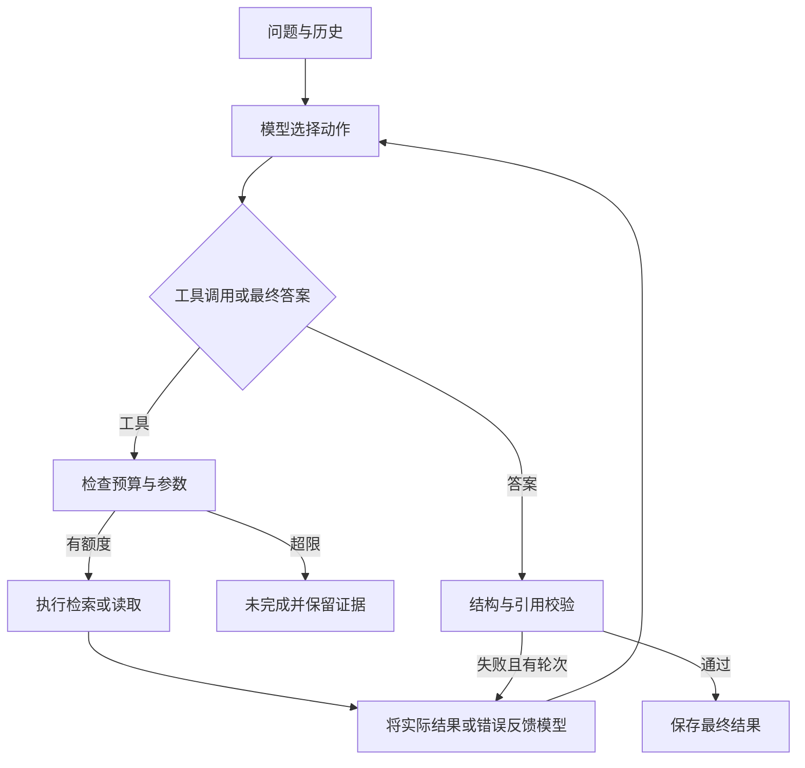

# 实现方案

我独立完成方案设计，借助 AI 实现代码结构、接口和说明文档，并根据开发检查调整实现。随后我配置环境、阅读代码并执行测试。详见 [贡献边界](04-ai-usage.md)。

采用原生 Python 循环，便于审查工具结果如何影响下一次模型调用。CLI 只负责参数与文件，runtime 组合模型、资料和执行器；没有引入 Agent 框架。

| 模块 | 职责 |
| --- | --- |
| schemas.py | 输入、资料、预算、工具参数和答案字段约束 |
| retrieval.py | jieba 分词、通用同义词、标题加权关键词排序 |
| tools.py | 工具定义、参数校验、读取证据与故障注入 |
| models.py | HTTPS Chat Completions 请求、错误归类、消息白名单 |
| mock_model.py | 显式的离线规则替身 |
| agent.py | 模型循环、逐工具计数、最终校验反馈与停止 |
| validation.py | 引用版本、片段与原文子串校验 |
| tracing.py | 独占运行目录、逐事件记录和凭据脱敏 |
| evaluation.py | 八组场景执行与自动属性断言 |

## 决策流程

模型决定检索词、读取对象、补查、追问或结束。程序不根据测试用例编号选择路径。工具只返回资料与执行结果；故障注入基于工具调用序号，与问题文本无关。

assistant 工具调用消息先加入消息历史，再追加带对应 tool_call_id 的 tool 结果，下一轮模型可观察完整执行结果。多个工具顺序执行并逐次计数；耗尽额度时不执行剩余工具，终止运行。已读证据仍保留，但不生成未经校验的成功结论。

## 数据与检索

文档 ID 与文档内片段 ID 必须唯一。运行时加载资料快照，保存原始资料文件哈希和语义一致的 corpus.json，模型不能修改资料。

分词后删除通用停用词。通用同义词包含报账/报销、出差/差旅、多久/期限等。评分为标题命中词数量乘 3，加正文命中词数量；按分数和文档 ID 稳定排序。检索最多返回 10 个候选，默认 5 个。摘要不等同于证据，最终引用需实际读取。

小资料集采用该方案降低外部依赖和运行成本。短词、语义变化和复杂范围可能漏检；没有宣称全量冲突发现能力。

## 引用与状态

程序验证文档属于本次读取成功的集合、版本相同、片段存在、引文为非空原文子串。answered 必须有答案和引用，不能含未解决冲突或缺口。needs_clarification 必须有追问，其他非成功状态必须解释原因。

程序不自动推断“新版覆盖旧版”。提示要求模型补查明确的替代关系、范围或优先级；没有依据时追问。是否遗漏语义冲突、引用是否足够支持结论，由场景检查和后续人工复核判断。

## 模型与运行边界

使用 httpx 直接调用 Chat Completions，不需要模型 SDK。官方 DeepSeek 域名发送 thinking=disabled，不请求或记录内部思维字段。记录普通行动说明、实际工具参数、结果和 usage 元信息。

依赖版本由 uv.lock 固定，每次运行 manifest.json 记录实际环境。首次安装解析到 httpx 0.28.1、pydantic 2.14.2、jieba 0.42.1、python-dotenv 1.2.4；测试使用 pytest 8.4.2。JSON schema 由 Pydantic 生成，服务端不要求 strict 模式，客户端严格验证。

HTTP 错误只记录状态码，连接与超时错误只记录分类，不把响应正文、Authorization 或密钥写入 Trace。日志序列化额外脱敏密钥。模型异常不自动重试；工具失败由模型观察后决定是否重试。

每轮请求设置 HTTPX 超时，不提供严格整任务墙钟中断。最多 10 轮模型调用与 8 次工具调用可配置；未知工具和参数错误也消耗一次调用额度。连续非法最终输出会耗尽轮次并停止。

## 协议参考

实现时核对了 [DeepSeek 工具调用](https://api-docs.deepseek.com/guides/tool_calls/)、[首次 API 调用](https://api-docs.deepseek.com/quick_start) 和 [Chat Completions 接口字段](https://developers.openai.com/api/reference/resources/chat/subresources/completions/methods/create)。仅 DeepSeek 参与实际在线验证，其他兼容接口未验证。
